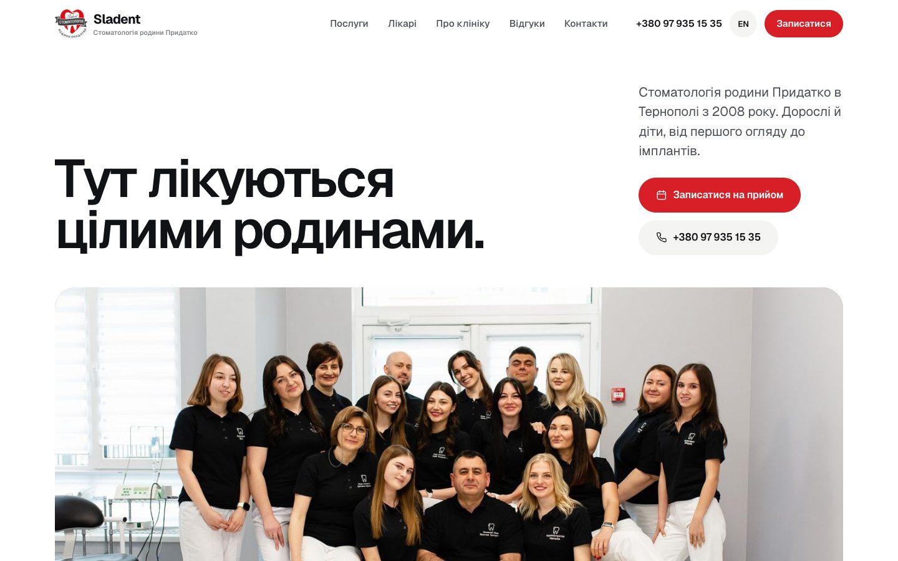

# Sladent

Website for [Sladent](https://sladent.com/), my family's dental clinic in Ternopil, Ukraine. I built it and keep it running.

**[sladent.com](https://sladent.com/)** · [English version](https://sladent.com/en/) · [Games and cartoons for kids](https://sladent.com/kids/)

## What it is

Seven pages in Ukrainian and English: home, services, doctors, about, reviews, contact, and a 404. Every "book" button leads to the booking form on the contact page, which runs on an Elfsight widget. The phone number is one tap away everywhere, and phones get a call and book bar at the bottom.

The content sticks to what the clinic can stand behind: the clinic's own team photos, real cases from its Instagram, and real Google reviews (4.8 from 93). Claims nobody could source were removed.

`kids/` is a separate app for the waiting room and the chair TV: games, six short cartoons and a sticker album. It has its own styles and links back to the main site.

## How it's built

Plain HTML, CSS and JavaScript. Netlify serves the files as they are, with no build settings.

- `site.css` is the one stylesheet for every page: Geist (self-hosted in `fonts/`), white with the clinic's red as the only accent, rounded photos.
- `site.js` does the small live parts: the mobile menu, the "open now" status in Kyiv time, the before/after slider, the review row and the video loops. The pages still read fine without it.
- Photos sit on their own average colour and fade in once loaded, phones get smaller copies through `srcset`, and the layout doesn't shift while things load.

The 14 HTML pages are generated by `build.py`, which keeps the header, footer and metadata identical across pages. Change copy there and run `python3 build.py` (needs Pillow) rather than editing one page by hand. The output is ordinary HTML, so the site itself still has no build step.

## Search

Most patients find a clinic through search, so the site does the local SEO work:

- Schema.org `Dentist` data with address, opening hours, coordinates and rating, plus an FAQ block on the home page
- `hreflang` between the Ukrainian and English pages, with `x-default`
- `sitemap.xml` and `robots.txt`
- A 301 from the Netlify subdomain to `sladent.com`, so only one domain gets indexed

[SEO.md](SEO.md) is the plan for everything outside the code, starting with the Google Business Profile.

## Running it

Open `index.html` in a browser, or serve the folder with any static server. Pushing to `main` deploys to Netlify.
